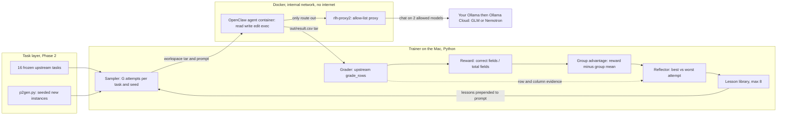
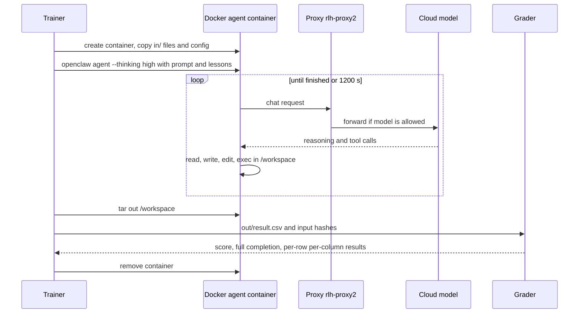
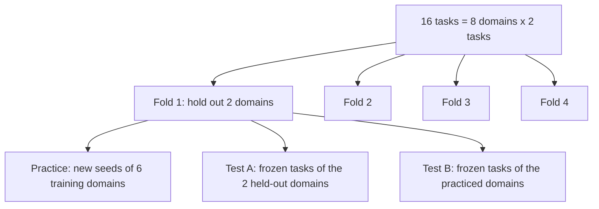
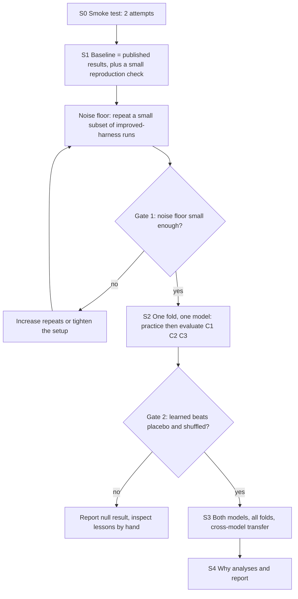

# Runtime harness improvement on Indic Harness Bench Phase 2

Status: PROPOSED design with baselines in progress (updated 2026-11-25).
Branch: [`rl-harness`](https://github.com/aniketqw/indic-harness-benchv2/tree/rl-harness) of the fork
`aniketqw/indic-harness-benchv2` (upstream: `yahall0/indic-harness-benchv2`).

## 1. Framing: this is harness improvement, not training the model

An agent's performance depends on the **model** and on the **harness** around it: the instructions it receives, the
tools and limits it runs with, and how its attempts are selected and scored. The models here (GLM-5.3-Flash,
Nemotron 3 Super on Ollama Cloud) are frozen, so their weights never change. We improve the harness, specifically its
**guidance layer** (short lessons added to the prompt), using the benchmark's grader as a reward signal, in the spirit of
GRPO's group-relative comparison.

> Honest label: *training-free, reward-driven harness optimization*. It is **not** reinforcement learning on the model.
> Real GRPO on an open model is a separate optional track (section 10).

Why Phase 2: published results show model-specific, fixable failures. GLM gets field values wrong (worst with Hindi
files); Nemotron runs out of budget and writes no file. A harness change could plausibly address both.

Research questions
1. **RQ1 Baseline:** the published Phase 2 results per model, language and task (not re-run), checked by a small reproduction run.
2. **RQ2 Effect:** does reward-derived guidance beat (a) no guidance and (b) an equal-length placebo on held-out tasks?
3. **RQ3 Mechanism:** which fields, languages and failure types change, and which lessons matter?
4. **RQ4 Transfer:** new seeds of practiced tasks, unseen domains, the other model, other instruction languages.

## 2. System architecture

What is the "harness" here? Everything in the diagram except the frozen model: guidance text, tool set, limits
(1200 s, 32,768-token responses, 131,072-token context, high thinking), the internal-network sandbox and the grader.
Only the **lesson library** is optimized; the rest is held fixed so results are attributable.

## 3. One attempt, step by step

Isolation: the agent container sits on an internal Docker network with no internet and no host mounts. The proxy
refuses everything except chat requests for the two allowed models (tested: `/api/pull` and other models return 403).

## 4. Reward

`reward = correct fields / (fields in expected rows + extra rows)` from upstream `grade_rows`, range 0 to 1. **Fully
correct** (all fields) is tracked separately and is the headline metric. Tampering with inputs zeroes the score upstream.
Infrastructure failures (harness error, provider 5xx) get no reward and are excluded. No speed bonus or extra terms
(Bespoke Labs found simple correctness rewards more stable than composite ones).

## 5. Data and splits

Practice only on **seeded** instances; test on the **frozen** upstream instances so results connect to the Phase 2 report.
Each task is held out exactly once across the four folds. Excluded from seeded practice: `03-bus-roster` (valid for 4 of
20 seeds) and `08-search-normalization` (ignores the seed). Seeding check: 296 of 320 generated instances valid.

## 6. Conditions and factors

| Condition | Guidance in the prompt |
|---|---|
| C0 baseline | none: the published results, not re-run (plus a small reproduction check) |
| C1 placebo | generic text of equal length |
| C2 learned | lessons from the practice phase |
| C3 shuffled | lessons from a different domain, equal length |
| C4 optional | hand-written lessons targeting the known failure modes |

Factors: model (GLM, Nemotron) x prompt language (en, hi, hinglish) x file language (en, hi). Evaluated at temperature 0.
Practice sampling uses temperature 0.7 so a group of attempts differs.

## 7. Experiment procedure with gates

Practice step: for each training task and seed, sample G=4 attempts, compute group-relative advantage
(reward minus group mean, divided by std), skip groups with no spread, and let the reflector turn the best-vs-worst
difference into at most two general lessons, using the grader's row and column results as evidence. The library is
capped at 8 and consolidated each epoch.

## 8. Analyses ("why")

- Per-field deltas: which columns and rules flip from wrong to right; per-task and per-language effects with
  task-clustered bootstrap intervals (the task is the unit, as in the original study).
- Failure taxonomy before and after: no file (budget), wrong values, missing or extra rows, header or format, timeout.
- Leave-one-lesson-out ablation; lesson language (English vs Hindi or Hinglish); number of lessons.
- Cost: tokens, turns, elapsed time (a longer prompt is itself an effect).
- **Claim rule:** a change counts only if it exceeds the noise floor **and** beats C1 and C3 (and the published baseline).

## 9. Baseline: the published results (we do not re-run them)

**Policy.** "Without harness improvement" is already measured by the published studies, on the same models. We do not
re-run those plain conditions. We run only the improved-harness conditions (and the equal-length placebo and shuffled
controls, which are the same-harness comparison). A small **reproduction check** (a handful of plain runs, not 96) will
confirm that our harness behaves like the published one before we rely on the comparison.

Models (frozen, served by Ollama Cloud; the model IDs used by the published code and by our runs):

| Study | Model | ID used by the study | ID on your Ollama (ours) | Published headline |
|---|---|---|---|---|
| Phase 1 | GPT-OSS-20B | `gpt-oss:20b` | `gpt-oss:20b-cloud` | mean 39.98/100 over 50 tasks x 3 languages |
| Phase 1 | Nemotron 3 Super | `nemotron-3-super` | `nemotron-3-super:cloud` | mean 51.21/100 |
| Phase 2 | GLM-5.3-Flash | `glm-5.3-flash` | `glm-5.3-flash:cloud` | 74 of 96 fully correct (77.1%) |
| Phase 2 | Nemotron 3 Super | `nemotron-3-super` | `nemotron-3-super:cloud` | 72 of 96 fully correct (75.0%) |

Our main experiment uses the two **Phase 2** models. Phase 1 (GPT-OSS) is optional and secondary.

Where the published baseline lives in this repo:

| Data | File |
|---|---|
| Phase 2, per task and model (correct out of 6 conditions) | [`paper_kit/tables/p2_v21_by_task.csv`](https://github.com/aniketqw/indic-harness-benchv2/blob/rl-harness/paper_kit/tables/p2_v21_by_task.csv) |
| Phase 2, by model, instruction language, file language | [`paper_kit/tables/p2_v21_by_factor.csv`](https://github.com/aniketqw/indic-harness-benchv2/blob/rl-harness/paper_kit/tables/p2_v21_by_factor.csv) |
| Phase 2, outcome types per model and file language | [`paper_kit/tables/p2_v21_outcomes_model_workspace.csv`](https://github.com/aniketqw/indic-harness-benchv2/blob/rl-harness/paper_kit/tables/p2_v21_outcomes_model_workspace.csv) |
| Phase 2, findings report | [`phase2/reports/v21-findings.html`](https://github.com/aniketqw/indic-harness-benchv2/blob/rl-harness/phase2/reports/v21-findings.html) |
| Phase 1, all 300 conditions (task, language, model, score) | [`output/pdf/report_data/matched_conditions.csv`](https://github.com/aniketqw/indic-harness-benchv2/blob/rl-harness/output/pdf/report_data/matched_conditions.csv) |
| Phase 1, per-task scores | [`output/pdf/report_data/task_score_atlas.csv`](https://github.com/aniketqw/indic-harness-benchv2/blob/rl-harness/output/pdf/report_data/task_score_atlas.csv) |

Limits of using the published baseline:
- Phase 2's per-condition raw rows are not in the repo; only per task and model (out of 6) and factor-level tables. So
  comparisons are at the task-by-model level, not per prompt-language-by-file-language cell.
- The published runs used the study's own relay and accounting stack; ours uses a proxy and host grading. Hence the
  reproduction check and the placebo and shuffled controls, which are run in our harness.
- One run per condition at temperature 0 in the study; we cannot see its run-to-run noise.

Our own runs so far (all in [`rlharness/results/`](https://github.com/aniketqw/indic-harness-benchv2/blob/rl-harness/rlharness/results)):
- Phase 2 smoke test, one task (`05-grower-payout`, English): both models fully correct. Published for that task:
  GLM 6/6, Nemotron 2/6 conditions.
- Two self-run plain baselines were **stopped on purpose, unfinished** (Phase 1: 54 of 72 attempts; Phase 2: 2 of 96)
  because the published results replace them. Their files are kept for the record only and are **not** a baseline.

An earlier, separate pilot by another session (simple 3-tool loop, not OpenClaw, no placebo) is noted in
[`PILOT_NOTES.md`](https://github.com/aniketqw/indic-harness-benchv2/blob/rl-harness/rlharness/PILOT_NOTES.md) section 8; it is not part of this baseline.

## 10. Optional Track B: real RL on a small open model

GRPO with LoRA on a small open model (for example Qwen3-1.7B or 3B) using seeded Phase 2 tasks as the environment and
the same reward. It would answer "does real RL transfer?", not "can we improve GLM and Nemotron?". It needs a GPU; the
shared A6000 is marginal (GPU memory and a full home disk). Existing reference: an untrained Qwen3-1.7B scored
14.98/100 on phase-1 style prompts (other session; results in its own folder, not committed here).

## 11. Where everything lives (branch `rl-harness`)

| What | File |
|---|---|
| This design | [`rlharness/ARCHITECTURE.md`](https://github.com/aniketqw/indic-harness-benchv2/blob/rl-harness/rlharness/ARCHITECTURE.md) |
| Plain-language notes, checks, findings log | [`rlharness/PILOT_NOTES.md`](https://github.com/aniketqw/indic-harness-benchv2/blob/rl-harness/rlharness/PILOT_NOTES.md) |
| Phase 2 attempt runner (OpenClaw, grader) | [`rlharness/p2run.py`](https://github.com/aniketqw/indic-harness-benchv2/blob/rl-harness/rlharness/p2run.py) |
| Phase 2 baseline runner | [`rlharness/p2baseline.py`](https://github.com/aniketqw/indic-harness-benchv2/blob/rl-harness/rlharness/p2baseline.py) |
| Seeded task generator | [`rlharness/p2gen.py`](https://github.com/aniketqw/indic-harness-benchv2/blob/rl-harness/rlharness/p2gen.py) |
| Allow-list proxy to Ollama | [`rlharness/proxy.py`](https://github.com/aniketqw/indic-harness-benchv2/blob/rl-harness/rlharness/proxy.py) |
| Phase 1 OpenClaw runner, reward, loop | [`oc_runner.py`](https://github.com/aniketqw/indic-harness-benchv2/blob/rl-harness/rlharness/oc_runner.py), [`reward.py`](https://github.com/aniketqw/indic-harness-benchv2/blob/rl-harness/rlharness/reward.py), [`loop.py`](https://github.com/aniketqw/indic-harness-benchv2/blob/rl-harness/rlharness/loop.py), [`baseline.py`](https://github.com/aniketqw/indic-harness-benchv2/blob/rl-harness/rlharness/baseline.py) |
| Result export script | [`rlharness/export_results.py`](https://github.com/aniketqw/indic-harness-benchv2/blob/rl-harness/rlharness/export_results.py) |
| Stored results | [`rlharness/results/`](https://github.com/aniketqw/indic-harness-benchv2/tree/rl-harness/rlharness/results) |
| Phase 2 upstream (frozen tasks, grader, reports) | [`phase2/`](https://github.com/aniketqw/indic-harness-benchv2/tree/rl-harness/phase2), [findings](https://github.com/aniketqw/indic-harness-benchv2/blob/rl-harness/phase2/reports/v21-findings.html) |
| Paper analysis (course case studies) | `p0/rl-papers/ANALYSIS.md` (local only, not in this repo) |

Local only, git-ignored: `rlharness/runs/` (raw attempts, transcripts, logs).

## 12. Budget, risks and limits

- One Phase 2 attempt takes about 2 to 5 minutes. The plain baseline is not re-run (published results), which removes the largest single cost. The
  remaining runs (placebo, shuffled, learned, practice) are still a multi-day quota, hence the stage gates.
- Small samples and non-determinism at temperature 0; lessons may be generic or give a null result; absolute scores can
  differ from the published Phase 2 report (different relay, accounting and host), hence the reproduction check and the same-harness controls.
- Translations and tasks are AI-authored (upstream caveat); no claim about Indian languages in general.
