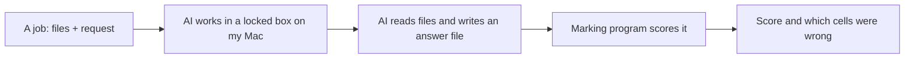
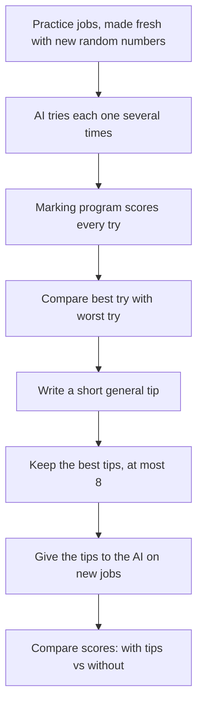

# What we are doing, in plain language

(The technical version is [`ARCHITECTURE.md`](ARCHITECTURE.md). Read this one first.)

## The idea in one sentence

We give an AI assistant some office-style jobs, check its work automatically, and test whether **short written tips**
that we learn from its own good and bad attempts help it do better on jobs it has never seen.

We do **not** change the AI itself. We only change the instructions and tips around it.

## 1. The test we are using

Imagine a pile of small office jobs, such as "work out each farmer's payout from these spreadsheets and the rules in this
notice". Each job comes with:
- some input files (spreadsheets and a notice with rules),
- a plain request, written in **English, Hindi or Hinglish** (Hindi written in English letters),
- a **marking program** that checks the answer cell by cell and gives a score from 0 to 100%.

The published benchmark ("Indic Harness Bench") has two parts:
- **Phase 1:** 50 jobs, English / Hindi / Hinglish requests.
- **Phase 2:** 16 harder jobs from 8 areas (finance, schools, farming, translation, city services, delivery, clinics, archives).
  Here even the **files** can be in English or Hindi. This is the part we are building on.

## 2. What the published results already show

In Phase 2, two AI models (called GLM and Nemotron) got about 76% of jobs fully right. They fail in **different** ways:
- GLM usually hands in an answer, but gets some details wrong, especially when the files are in Hindi.
- Nemotron sometimes runs out of its thinking budget and hands in **nothing**.

Different failures suggest that different tips might help each one. That is our opening.

## 3. What we are trying

Think of a student, a set of practice exams, and a tutor.

1. The student (the AI) attempts a practice job several times.
2. The marking program scores each attempt.
3. The tutor compares the best and the worst attempt for the same job and writes a short, general tip, for example:
   "Check that every row from the input appears in your output."
4. Good tips are kept in a short list (at most 8).
5. Later, the student gets that list along with new jobs, and we see whether the scores improve.

The student never changes. Only the instructions around it do. That is what we mean by **improving the harness**
("harness" = everything around the AI: instructions, tools, time limits and the checking).

## 4. How one attempt runs

The "locked box" is a sealed container with no internet. The only thing it can talk to is the AI service, through a
small gate that allows nothing else.

## 5. How the learning loop works

Practice jobs are not the exam jobs. We can make new versions of a practice job (same rules, different numbers), so the
AI cannot just memorize answers.

## 6. How we will know it worked (fair comparison)

If scores go up with tips, that alone proves nothing. Longer instructions might help by themselves, or luck might.
So every test compares **four** versions on the same unseen jobs:

| Version | What the AI gets |
|---|---|
| Plain | just the job |
| Filler | the job plus generic advice of the same length ("work carefully") |
| Real tips | the job plus the tips we learned |
| Wrong tips | the job plus tips learned from a different kind of job |

We also repeat the plain version several times to see how much scores wobble by chance. We will only say the tips helped
if the gain is **bigger than that wobble** and **beats both filler and wrong tips**.

Then we look at **why**: which cells and rules went from wrong to right, which languages gained, and which single tips mattered.

## 7. Where we are right now (updated 2026-11-25)

| Step | Status |
|---|---|
| Tools built: sealed box, marking, new-practice-job maker | Done and tested |
| Phase 2 test run, one job, both AIs | Done: both fully right (GLM 297 s, Nemotron 106 s) |
| **Phase 2 "plain" baseline** (96 attempts) | **Just started: 1 of 96 done**, expected 3 to 4 more hours |
| Phase 1 "plain" baseline (GPT-OSS, 72 attempts) | **Not finished: 53 of 72 done** (average 43%) |
| Practice and tips | Not started (waits for the baseline) |

Everything so far is a **baseline**: how the AI does with **no** tips. No tip has been tested yet, so we have no result
about whether tips help.

Important: the Phase 1 numbers are a side check on a different AI (GPT-OSS) and different jobs. They are not the main
result. Numbers will only be quoted as final once a run is complete.

## 8. Words used in the documents

- **Harness:** everything around the AI except the AI itself.
- **Baseline:** how the AI does with no tips. The yardstick for everything else.
- **Reward:** the score from the marking program (0 to 1).
- **Held-out / unseen:** jobs the AI never practiced on, used only for testing.
- **Seed:** a number that makes a new version of a practice job; same rules, different data.
- **Placebo (filler):** a fake tip of the same length, used to check the real tips are doing the work.
- **Noise floor:** how much a score moves between identical runs, just by chance.
- **GRPO:** the training method that inspired the "compare the best and worst try" step. We borrow the comparison idea.
  We do not train the AI, so this is **not** reinforcement learning on the model.

## 9. Where things are

All files are on the `rl-harness` branch of the fork:
<https://github.com/aniketqw/indic-harness-benchv2/tree/rl-harness/rlharness>

- [`ARCHITECTURE.md`](ARCHITECTURE.md): technical design, diagrams and a full file map.
- [`PILOT_NOTES.md`](PILOT_NOTES.md): running notes, what each check does, findings and caveats.
- [`results/`](results): saved baseline numbers.
